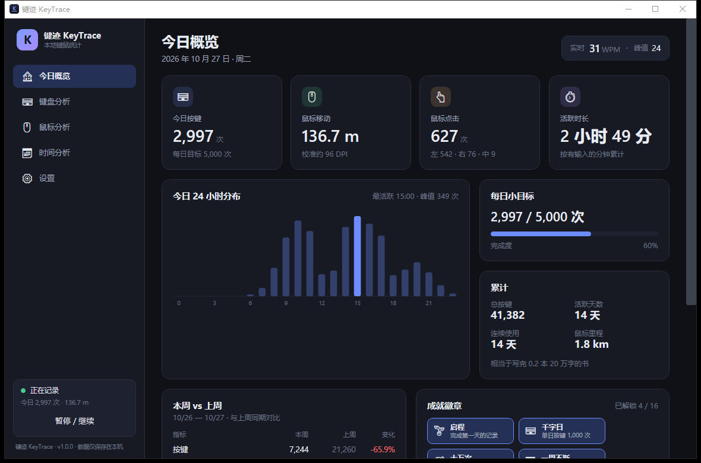
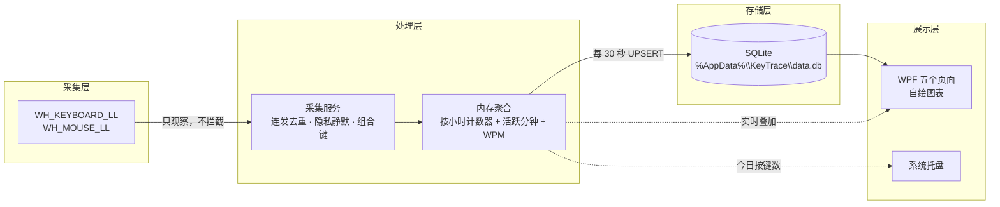

# ⌨ 键迹 KeyTrace

> **本地键鼠行为统计 · 可视化日报 · 隐私优先**
>
> 只看数字，不看内容。所有数据留在你自己的电脑里。

[](https://dotnet.microsoft.com/)
[](#系统要求)
[](LICENSE)
[](#测试)



---

## 这是什么

KeyTrace 是一个常驻在系统托盘的 Windows 小工具：它统计你**按了多少次键、鼠标移动了多远、点了多少次、什么时候最活跃**，
并把这些数字变成好看的日历、热图和趋势图。

它**不知道你打了什么字**——只记录 Windows 虚拟键码（例如 `VK_A = 65`）的计数，不记录焦点、输入内容、剪贴板或截图。

---

## 功能

### 核心
- 每个按键的点击次数（按 VK 码统计，自动忽略按键连发）
- 按天存储的汇总数据（SQLite）
- 鼠标移动距离（像素 → 米，支持 DPI 校准）
- 五个可视化页面：今日概览 / 键盘分析 / 鼠标分析 / 时间分析 / 设置

### 键盘
- QWERTY 键盘热图（按频率渐变，16px 也能看清）
- 实时打字速度 WPM 估算
- Top 10 高频按键排行
- 常用快捷键识别（`Ctrl+C` / `Ctrl+V` / `Win+…`）

### 鼠标
- 左键 / 右键 / 中键点击次数与占比环形图
- 滚轮格数
- 划 10cm 实测 → 反推 DPI 校准系数
- 点击屏幕热区（可选，默认关闭，只存 20×10 的粗网格）

### 时间
- 一周 × 24 小时热力网格
- 月历热力图（哪天最肝一目了然）
- 连续使用天数 / 总活跃天数
- 本周 vs 上周对比

### 趣味
- 16 个成就徽章（「万字日」「千公里」「连续 30 天」…）
- 每日按键小目标
- 累计按键换算成「写完了几本书」

### 工程与隐私
- 只记按键码，不记按键内容
- 前台窗口命中敏感进程 / 关键词时**整段时间完全静默**（默认带 KeePass、1Password、Bitwarden 等）
- 一键导出 CSV / 一键清空数据
- 开机自启、关闭按钮最小化到托盘
- 单文件 exe，目标机不需要安装 .NET

---

## 隐私

> 这是这类工具的红线，写在最前面。

| 会记录 | 不会记录 |
| --- | --- |
| 虚拟键码的**次数** | 按键对应的字符 / 输入内容 |
| 鼠标移动的**像素距离** | 鼠标轨迹的原始坐标 |
| 左/右/中的**点击次数** | 点击了什么元素 |
| 按小时的**汇总** | 前台窗口标题、进程名（只在内存里比对，不落盘） |
| 可选：20×10 的点击粗网格 | 屏幕截图、剪贴板、网络请求 |

- 数据文件：`%AppData%\KeyTrace\data.db`（SQLite），**不联网、不上传、无遥测**。
- 想换位置（例如放到 U 盘）：设置环境变量 `KEYTRACE_HOME` 指向任意目录即可。
- 卸载 / 清空：设置页「清空所有数据」，或直接删除 `%AppData%\KeyTrace` 整个目录。

详见 [docs/PRIVACY.md](docs/PRIVACY.md)。

---

## 快速开始

### 方式一：直接用发布版

1. 到 [Releases](../../releases) 下载 `KeyTrace.exe`（win-x64，单文件，约 70 MB）。（作者是区，用不了要用脚本）
2. 双击运行。首次启动时 Windows SmartScreen 可能提示「未知发布者」（未做代码签名），选择「更多信息 → 仍要运行」。
3. 程序默认最小化到系统托盘，双击托盘图标打开主窗口。

> 不需要安装 .NET 运行时：发布版是 self-contained 单文件。

### 方式二：从源码构建

需要 **.NET 8 SDK**（Windows 10/11）。

```powershell
git clone https://github.com/your-account/KeyTrace.git
cd KeyTrace

# 运行
dotnet run --project src/KeyTrace.App/KeyTrace.App.csproj

# 跑测试
dotnet test

# 发布单文件 exe（输出 artifacts/publish/KeyTrace.exe）
./scripts/publish.ps1
```

---

## 技术栈

| 模块 | 选型 | 说明 |
| --- | --- | --- |
| 语言 | C# 12 / .NET 8 | WPF + `net8.0-windows` |
| 全局钩子 | Win32 `SetWindowsHookEx`（P/Invoke） | 独立消息泵线程，只观察不拦截 |
| 本地存储 | Microsoft.Data.Sqlite | 纯本地 SQLite，WAL 模式 |
| UI | WPF + 手写 MVVM | 无第三方 MVVM / 图表依赖 |
| 图表 | 自定义 `FrameworkElement` + `DrawingContext` | 折线、柱状、环形、热图、月历 |
| 系统托盘 | H.NotifyIcon.Wpf | 托盘菜单 + 实时 tooltip |
| 开机自启 | `HKCU\...\Run` | 无需管理员权限 |
| 部署 | Self-contained Single File | 单个 exe，目标机免装运行时 |

### 为什么不用现成的图表库？

LiveCharts2 / ScottPlot 会带来 SkiaSharp 等原生依赖，单文件发布要额外处理原生库，
而这里需要的图形（24h 柱状、7 天折线、环形占比、热力网格、月历）都很简单。
用 `OnRender` 手写约 600 行就能画完，零依赖、启动快、深色主题完全可控。

---

## 架构



设计要点：

1. **钩子回调极快返回**：只解包 `KBDLLHOOKSTRUCT` / `MSLLHOOKSTRUCT`，做纯数值累加，不做 IO、不弹 UI。
2. **按小时聚合**：内存里维护当前小时的计数器，定时批量 UPSERT，避免存原始事件流（一年几千万行）。
3. **落盘幂等**：所有写入都是 `INSERT ... ON CONFLICT DO UPDATE`，崩溃最多丢最后一个落盘周期。
4. **实时视图 = 已落盘 + 在途**：界面读库后再叠加内存中尚未落盘的增量，用户看到的是"现在"。
5. **静默优先**：前台窗口命中隐私名单时，连 KeyUp 状态机都跳过，鼠标锚点重置，恢复后不会把"跳变"算进距离。

更多细节见 [docs/ARCHITECTURE.md](docs/ARCHITECTURE.md)。

---

## 目录结构

```
KeyTrace/
├── src/
│   ├── KeyTrace.Core/              # 与 UI 无关的核心库（net8.0-windows）
│   │   ├── Aggregation/            # 按小时聚合、点击热区网格
│   │   ├── Achievements/           # 成就定义与判定
│   │   ├── Calibration/            # 像素 → 米 的换算
│   │   ├── Collection/             # 采集服务：去重 / 静默 / 定时落盘
│   │   ├── Diagnostics/            # 文件日志
│   │   ├── Input/                  # 全局钩子、前台窗口、输入契约
│   │   ├── Lifetime/               # 开机自启
│   │   ├── Models/                 # 数据模型
│   │   ├── Privacy/                # 隐私静默判定
│   │   ├── Settings/               # 设置与 JSON 持久化
│   │   ├── Stats/                  # 实时视图、Streak、换算
│   │   ├── Storage/                # SQLite 建表 / 仓储 / CSV 导出
│   │   └── Text/                   # 键名映射、QWERTY 布局
│   └── KeyTrace.App/               # WPF 应用
│       ├── Controls/               # 自绘图表控件
│       ├── Infrastructure/         # MVVM 基类、格式化、调色板
│       ├── Services/               # 托盘、对话框、图标加载
│       ├── ViewModels/             # 五个页面 + 主窗口
│       ├── Views/                  # 五个页面视图
│       └── Themes/                 # 深色主题与控件模板
├── tests/
│   └── KeyTrace.Core.Tests/        # 90 个单元测试
├── docs/                           # 架构、隐私、构建说明
├── scripts/                        # 发布、图标生成、截图脚本
└── .github/                        # CI 与 Issue/PR 模板
```

---

## 数据表

`daily_stats` — 每日汇总

| 字段 | 类型 | 说明 |
| --- | --- | --- |
| date | TEXT PK | `YYYY-MM-DD` |
| total_keys | INTEGER | 当日总按键数 |
| mouse_m | REAL | 当日鼠标移动（米，写入时按当时校准值计算） |
| mouse_px | REAL | 当日鼠标移动（像素，权威值） |
| total_clicks / left_clicks / right_clicks / middle_clicks | INTEGER | 点击次数 |
| scroll_steps | INTEGER | 滚轮格数 |
| active_min | INTEGER | 活跃分钟数（有输入的分钟数） |

`key_daily`（date, key_code PK）· `hourly_dist`（date, hour PK）· `combo_daily` · `click_zone` · `active_minute` · `achievements`

> 界面上的"米"永远由 **像素 × 当前校准系数** 实时计算，所以重新校准后历史数据会自动按新比例显示。

---

## 开发

```powershell
dotnet build                     # 构建全部项目
dotnet test                      # 90 个单元测试
dotnet run --project src/KeyTrace.App/KeyTrace.App.csproj
./scripts/publish.ps1            # 单文件发布
python scripts/make_icon.py      # 重新生成多尺寸图标（需要 Pillow）
```

调试时可以用独立数据目录，避免污染真实统计：

```powershell
$env:KEYTRACE_HOME = "$PWD\artifacts\dev-home"
dotnet run --project src/KeyTrace.App/KeyTrace.App.csproj
```

### 测试

Core 层（聚合、校准、隐私、仓储、成就、CSV）有 90 个 xUnit 测试，全部在 CI 中运行：

```powershell
dotnet test tests/KeyTrace.Core.Tests/KeyTrace.Core.Tests.csproj
```

---

## 常见问题

**Q：杀毒软件报毒？**
全局键鼠钩子属于敏感 API，部分启发式引擎会对未签名的此类程序报警。本项目开源、无网络代码、无上传行为，可自行审计或从源码构建。

**Q：为什么统计不到按键？**
钩子可能被安全软件拦截，或被以更高权限运行的前台程序"吃掉"（Windows 的低级钩子对提权窗口失效）。尝试以管理员身份运行；托盘提示"采集未运行"时可在日志中查看原因。

**Q：鼠标距离看起来偏大 / 偏小？**
鼠标 DPI 与系统缩放都会影响像素→物理距离的换算。到「设置 → DPI 校准」，按住鼠标沿直线划过真实 10 厘米再点「完成校准」。

**Q：数据和设置存在哪？**
`%AppData%\KeyTrace\`（`data.db`、`settings.json`、`logs/`）。可整体备份或删除；设置页也能导出 CSV。

**Q：支持 macOS / Linux 吗？**
不支持。全局低级键鼠钩子、WPF、注册表自启都是 Windows 专属实现。

---

## 路线图

- [ ] 分应用统计（可选的进程名白名单，仍不记录标题）
- [ ] 多语言（英文 / 日文）
- [ ] 数据导入 / 多设备合并（手动导出导入）
- [ ] 更细的成就与周报分享卡片
- [ ] 代码签名与安装包

---

## 贡献

欢迎 Issue 与 Pull Request。提交前请先看 [CONTRIBUTING.md](CONTRIBUTING.md)，
并确保 `dotnet build`、`dotnet test` 全绿。安全问题请按 [SECURITY.md](SECURITY.md) 私下反馈。

## 许可证

[MIT](LICENSE) © 2026 KeyTrace contributors

## 免责声明

本工具用于个人时间与效率管理。请勿用于监控他人设备；在共用电脑上使用前，请确保已告知设备使用者。
